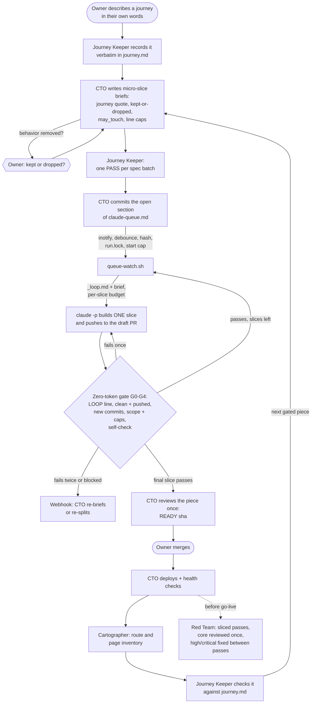

# noxibuilds-workshop

*An owner-in-the-loop multi-agent build workflow, by [@NoxiBuilds](https://x.com/NoxiBuilds).*


**noxibuilds-workshop** is a starter kit for building real software with a small team of AI agents while one
human stays firmly in charge. The owner describes what users should experience in their own words; a CTO agent
turns that into tiny, scoped briefs; a headless Claude Code loop builds one micro-slice at a time behind a
zero-token gate; and specialist agents map the code, guard the user journeys, police the machine, and red-team
the result. One command scaffolds a new project with all of it, isolated from every other project on the box.

> **New to agents?** Tell your Grok Bot: *"Set me up from https://github.com/NoxiMoxi/noxibuilds-workshop"*.
> It reads [GROKBOT.md](GROKBOT.md), creates a **Setup Guide** bot, and that bot walks you through everything, one step at a time.

---

## Contents
- [Start here: GROKBOT.md](GROKBOT.md) (guided setup)
- [Requirements and stack](#requirements-and-stack)
- [How it works](#how-it-works)
- [Core principles](#core-principles)
- [Quickstart](#quickstart)
- [Repository layout](#repository-layout)
- [Configuration reference](#configuration-reference)
- [Safety model](#safety-model)
- [FAQ](#faq)
- [Contributing](#contributing) and [License](#license)

---

## Requirements and stack

| Component | Status | Used for |
| --- | --- | --- |
| **[Claude Code CLI](https://docs.anthropic.com/en/docs/claude-code)** | **Required** | The builder. The watcher runs it headless (`claude -p --output-format stream-json`), one micro-slice per run. Needs an Anthropic plan or API key. Models are chosen per piece through the `opus` / `sonnet` aliases (configurable). |
| **git**, **bash**, **jq**, **flock** (util-linux) | **Required** | The watcher, the gate, and `init.sh`. |
| **inotify-tools** | **Required** (for watching) | Event-driven start: zero model calls while idle. `--check` and `--plan` work without it. |
| **systemd user services** | **Required** (for unattended runs) | Keeps the watcher running. You can also run `queue-watch.sh` in a terminal. |
| **[GitHub CLI `gh`](https://cli.github.com)** | **Required** | Claude opens draft PRs with it; the CTO reviews with it. |
| **Grok Bot** (multi-agent assistant app) | **Recommended** (reference setup) | Runs the CTO, Cartographer, Journey Keeper, Lab Warden and Red Team agents, routes their messages, and runs routines (for example the run-finished webhook). |
| **Python 3** (stdlib only) | Optional | `redteam/slicer.py` and the test suite's helpers. |
| **curl** | Optional | Run-finished / blocker webhook. |
| **[Ollama](https://ollama.com)** with a small instruct model (for example a 14B-class Qwen) | Optional | Cheap local triage: the Red Team's first sweep over each slice, and any advisory per-slice check you add after the gate. Not called by the shipped scripts. |
| **Docker** | Optional | Throwaway test stacks (databases, browsers) under the Lab Warden's limits. |

**Agent platform.** The role files in [`bots/`](bots/) are plain Markdown personas. They work with any capable
agent platform that can hold standing instructions, read a git repo, and message the owner. Grok Bot is the
reference setup this kit was developed with.

---

## How it works

### Roles

| Role | Who | Owns |
| --- | --- | --- |
| **Setup Guide** | Agent ([setup-guide.md](bots/setup-guide.md)) | Walks a new user through the whole setup, one checked step per message, then hands off to the CTO. |
| **Owner** | Human | User journeys in their own words, "kept or dropped?" answers, merges, anything public. |
| **CTO** | Agent ([cto.md](bots/cto.md)) | Specs and micro-slice briefs, the queue, one review per piece, deploys after the owner merges. |
| **Cartographer** | Agent ([cartographer.md](bots/cartographer.md)) | Code map and context packs, route/page inventory after every deploy, Red Team slices. |
| **Journey Keeper** | Agent ([journey-keeper.md](bots/journey-keeper.md)) | `journey.md`, kept verbatim; one-line PASS (or detailed FAIL) on spec batches and inventories. |
| **Lab Warden** | Agent ([lab-warden.md](bots/lab-warden.md)) | The machine: approves folders, services, ports, containers, installs; hands out resource limits. |
| **Red Team** | Agent ([red-team.md](bots/red-team.md)) | Adversarial review in sliced passes with different models. |
| **Build loop** | Claude Code, headless | Exactly one slice per run, inside its `may_touch` scope, ending in a draft PR. |

### The loop



### What the watcher does, step by step
1. `inotifywait` watches the review-log's `docs/` folder and its branch ref. Events are debounced (`LOOP_DEBOUNCE`).
2. It hashes the **committed** top `open` section of `claude-queue.md`. No change, no run. The very first start only records a baseline.
3. One run at a time (`state/run.lock`). A task hash that has started more than `LOOP_MAX_STARTS` times logs `needs-owner` and stops.
4. It picks the first piece bullet with `brief:` and `branch: task/...`, then the first slice with no passed-gate record still on `origin/<branch>`.
5. The prompt is `docs/briefs/_loop.md` + the slice brief, capped at `LOOP_BRIEF_MAX_BYTES`. The model comes from the piece's `[tier: ...]` / `[model: ...]` tag (keyword fallback).
6. Claude runs with `--max-budget-usd min(LOOP_SLICE_BUDGET_USD, piece budget left)`. Cost is read from the run's own stream totals into `state/cost/<piece>.txt`.
7. The gate runs ([loop/GATES.md](loop/GATES.md)). Pass: next slice immediately. Fail: one fix run with the failure text. Second failure, `LOOP: blocked`, or budget exhausted: the chain stops and the webhook fires.

### Red Team in sliced passes
[redteam/SLICING.md](redteam/SLICING.md): seed each attack surface, expand one hop of imports, review the shared
core **once**, give each surface its own files plus signature stubs of the core it calls, keep every slice under
~120K tokens, and pack slices into passes run by different models. `redteam/slicer.py` automates this for Python.

---

## Core principles

- **Journey-first, in the owner's words.** `journey.md` is never paraphrased; every brief cites it by commit and line.
- **Kept or dropped?** Any behavior a change removes is listed and answered by the owner before it is queued.
- **`may_touch` scope.** Each brief declares the files it may change; the gate rejects anything else.
- **Micro-slices.** Small briefs, small diffs, line caps per slice, one draft PR per piece.
- **Cost caps.** Per-slice and per-piece budgets, a brief size cap, and a start cap per task.
- **Capped test growth.** Targeted tests on non-final slices, the full suite once per piece, tests at most ~35% of a slice.
- **The owner is the final gate.** Agents never merge, approve, or push to PR branches; anything public is the owner's call.
- **No secrets in chat.** Keys live in chmod-600 files, are read at runtime, and never appear in chat, logs, or argv.

---

## Quickstart

### Guided path (recommended for first-timers)

New to agents? Tell your Grok Bot:

> **"Set me up from https://github.com/NoxiMoxi/noxibuilds-workshop"**

Grok Bot follows [GROKBOT.md](GROKBOT.md): it creates a sidebar section and one bot, the **Setup Guide**
([bots/setup-guide.md](bots/setup-guide.md)). The Setup Guide then takes you through ten checked steps, one per
message: project name and goal, picking a machine, installing and verifying the prerequisites, creating your
repository, creating the other five bots one at a time (each tells you exactly what it needs), running `init.sh`
(dry run first), configuring the loop and its webhook (secrets only through masked forms, never chat), the
journey interview, and the F0 hello-loop piece that proves it all works. Then it hands you to the CTO.

### Manual path (advanced)

Prefer to wire it yourself, or using another agent platform? Follow these steps.

#### 1. Scaffold a project
```bash
git clone <this repository> noxibuilds-workshop
cd noxibuilds-workshop
./init.sh my-app --dry-run        # preview every path and the unit name; creates nothing
./init.sh my-app                   # creates ~/projects/my-app  (or: --root /path/to/projects)
```
`init.sh` refuses if `~/projects/my-app` or a `my-app-claude-watch.service` unit already exists, builds in a temp
folder and moves it into place in one step, and never installs, enables, or starts anything.

#### 2. Configure the loop
```bash
$EDITOR ~/projects/my-app/loop/loop.env        # chmod 600, no secrets in here
```
At minimum set:
```bash
LOOP_APP_REPO=/path/to/your/app/clone          # origin = your GitHub remote
LOOP_CLAUDE_BIN=/absolute/path/to/claude       # systemd does not load your shell PATH
LOOP_CLAUDE_FLAGS="--allowedTools ..."         # a narrow permission allowlist, never a blanket bypass
```
Make the G4 gate real by editing `LINT_CMD` and `TEST_CMD` in `~/projects/my-app/loop/bin/self-check.sh`.

Optional webhook for run-finished / blocked notifications:
```bash
# loop.env
LOOP_NOTIFY_URL=<your webhook URL>
# loop/notify.env  (already chmod 600; never commit it)
LOOP_NOTIFY_KEY=<webhook key>
```
The watcher POSTs `{"project","event","task","slice","detail","log"}` with `Authorization: Bearer <key>` when a
chain ends. `event` is one of `done`, `blocked`, `limit`, `needs-owner`, `error`.

Preview the next run without starting anything:
```bash
LOOP_CONFIG=~/projects/my-app/loop/loop.env ~/projects/my-app/loop/bin/queue-watch.sh --plan
```

#### 3. Install the user unit
```bash
mkdir -p ~/.config/systemd/user
cp ~/projects/my-app/loop/my-app-claude-watch.service ~/.config/systemd/user/
systemctl --user daemon-reload
systemctl --user enable --now my-app-claude-watch.service
journalctl --user -u my-app-claude-watch -f        # the run log itself is ~/projects/my-app/state/last-run.log
```
The first start records a baseline and runs nothing.

#### 4. Set up the agents in Grok Bot
1. Create one bot per role and paste its file as standing instructions: `bots/common.md` plus one of
   `cto.md`, `cartographer.md`, `journey-keeper.md`, `lab-warden.md`, `red-team.md`.
2. Point every bot at `~/projects/my-app/review-log/docs/brain/START.md` as its first read.
3. Connect GitHub so the CTO and Cartographer can read PRs and CI (read and comment; agents never merge).
4. Give the CTO a **webhook routine** for run-finished notifications, and put its URL and key in
   `loop.env` / `notify.env` as above. A routine that wakes the CTO on `blocked` or `done` closes the loop.
5. Introduce the bots to each other so they can message: CTO <-> everyone, Cartographer -> Journey Keeper.

Any other agent platform works the same way: standing instructions from `bots/`, repo access, a webhook.

#### 5. Write the first journey, then prove the loop
1. Have Journey Keeper interview the owner and record the first journey **verbatim** in `docs/brain/journey.md`.
2. Fill in `START.md` and `rules.md`.
3. Prove the plumbing: in `docs/claude-queue.md`, change `F0` (a trivial hello-loop piece) from `staged` to
   `open` and commit on the `review-log` branch. Within a minute Claude opens a draft PR and the gate reports.
4. From here the CTO writes real briefs from the journey.

---

## Repository layout

```
GROKBOT.md                       what Grok Bot does when told "set me up from this repo"
init.sh                          one-command project scaffold (--root, --dry-run; refuses to overwrite)
loop/
  queue-watch.sh                 watcher: inotify -> hash -> lock -> claude -p -> gate -> chain/stop -> webhook
  GATES.md                       G0-G4 spec; partial vs full self-check
  _loop.md.template              Claude's standing rules, inlined into every prompt
  brief.template.md              goal, journey quote, kept-or-dropped, may_touch, caps, acceptance
  claude-queue.md.template       queue format, with a staged hello-loop piece
  F0.1.brief.md.template         the hello-loop brief
  loop.env.example               every config key, documented
  notify.env.example             webhook key file (chmod 600)
  self-check.example.sh          G4 stub with --full / --partial
  claude-watch.service.template  systemd user unit
brain/                           START, rules, journey, decisions, review-log conventions (templates)
bots/                            common rules + setup-guide, cto, cartographer, journey-keeper, lab-warden, red-team
redteam/                         SLICING.md, slicer.py (stdlib), example-config.json
tests/                           smoke.sh (end-to-end, fake Claude), leak-scan.sh
```

A scaffolded project looks like this:

```
~/projects/my-app/
  review-log/          git repo (branch review-log): docs/claude-queue.md, docs/briefs/, docs/brain/
  loop/                loop.env, notify.env, my-app-claude-watch.service, bin/queue-watch.sh, bin/self-check.sh
  state/               run.lock, last-run.log, runs/, cost/, passed/, gate/
  wt-loop-run/         the one worktree Claude works in (created on the first run)
```

---

## Configuration reference

All keys live in `loop/loop.env` (re-read before every check; no restart needed). The unit sets `LOOP_CONFIG`.

| Key | Default | Meaning |
| --- | --- | --- |
| `LOOP_PROJECT` | set by init | Project name, `[a-z][a-z0-9-]{1,38}`; appears in logs and webhook payloads. |
| `LOOP_DOCS` / `LOOP_STATE` / `LOOP_WT` | set by init | Review-log `docs/`, state folder, Claude's worktree. |
| `LOOP_APP_REPO` | *(empty, required)* | Clone of the app repository; the worktree is added from it. |
| `LOOP_MAIN_BRANCH` | `main` | Base branch for new task branches. |
| `LOOP_QUEUE` | `claude-queue.md` | Queue file name inside `docs/`. |
| `LOOP_CLAUDE_BIN` | *(empty, required)* | Absolute path of the `claude` CLI. |
| `LOOP_CLAUDE_FLAGS` | *(empty)* | Extra flags (permission allowlist), word-split. |
| `LOOP_MODEL_SECURITY` | `opus` | Model for `security` / `fix` / `debug` pieces. Empty = CLI default. |
| `LOOP_MODEL_FEATURE` | `sonnet` | Model for everything else. Empty = CLI default. |
| `LOOP_SECURITY_KEYWORDS` | auth, migration, audit, ... | Regex that routes an untagged piece to the security model. |
| `LOOP_PIECE_BUDGET_USD` | `5` | Budget shared by all slices of a piece. |
| `LOOP_SLICE_BUDGET_USD` | `2` | Max per slice run. |
| `LOOP_BRIEF_MAX_BYTES` | `20480` | Cap on `_loop.md` + brief. |
| `LOOP_MAX_STARTS` | `4` | Starts per task hash before `needs-owner`. |
| `LOOP_DEBOUNCE` | `20` | Seconds of quiet before a check. |
| `LOOP_DEFAULT_MAX_LINES` / `LOOP_DEFAULT_MAX_TEST_LINES` | `300` / `120` | G3 caps when a brief sets none. |
| `LOOP_TEST_PATH_REGEX` | tests dirs, `test_*`, `*_test.*`, `*.test.*`, `*.spec.*` | What counts as a test file for G3/G4. |
| `LOOP_SELF_CHECK` | `loop/bin/self-check.sh` | G4 command: `--full` or `--partial -- <test files>`. |
| `LOOP_NOTIFY_URL` | *(empty)* | Webhook URL; empty disables notifications. |
| `LOOP_NOTIFY_ENV` | `loop/notify.env` | File (chmod 600) that sets `LOOP_NOTIFY_KEY`. |

`init.sh` also reads `PK_PIECE_USD`, `PK_SLICE_USD`, `PK_BRIEF_BYTES` (initial caps) and, for tests,
`SYSTEMD_USER_DIR` and `PK_SKIP_SYSTEMCTL`.

---

## Safety model

- **The owner merges.** Claude only opens draft PRs; agents review with comments and verdict lines, never merges, approvals, or pushes to PR branches.
- **Declared scope.** The gate rejects files outside `may_touch`, diffs over the line caps, unpushed or uncommitted work, and failing self-checks, without spending a token.
- **Bounded spend.** Per-slice and per-piece budgets, a brief size cap, one automatic fix run, and a start cap per task.
- **Nothing starts by itself.** `init.sh` installs nothing; the watcher's first start only records a baseline; only a committed queue change triggers a run.
- **Isolation.** Every project has its own folders, state, worktree, and unit name; the watcher is copied per project, so upgrading the kit never changes a running loop.
- **Least privilege for Claude.** `_loop.md` forbids widening permissions, chaining shell commands, touching secrets, or working outside the worktree. Pair it with a narrow `LOOP_CLAUDE_FLAGS` allowlist.
- **Secrets.** The webhook key is read from a chmod-600 file and passed to curl on stdin, never argv; it is never logged. `tests/leak-scan.sh` fails on keys, tokens, private keys, UUIDs, emails, unknown URLs, and home paths, and accepts a private term list (`LEAK_TERMS_FILE`) kept outside the repo.
- **Lab changes are reviewed.** The Lab Warden approves services, ports, containers, and edits to installed loop files.

---

## FAQ

**What does it cost?**
You set it. Defaults are $2 per slice and $5 per piece, enforced with `--max-budget-usd` and the run's own cost
totals. Idle costs nothing: the watcher is event-driven. Agent-platform costs depend on your plan; the efficiency
rules in `bots/common.md` (one PASS line, one gate per batch, silent quiet wakes) keep them low.

**Can I swap models?**
Yes. Set `LOOP_MODEL_SECURITY` / `LOOP_MODEL_FEATURE` to any model id the Claude Code CLI accepts, or tag a piece
`[model: <id>]`. Red Team passes deliberately use different models; the local Ollama sweep can use any instruct
model that fits your GPU.

**I've never used agents. Where do I start?**
Tell your Grok Bot "Set me up from https://github.com/NoxiMoxi/noxibuilds-workshop" and talk to the Setup Guide it
creates. Every bot introduces itself and tells you, in plain words, what it needs from you before it starts.

**Can I use it without Grok Bot?**
Yes. The loop (`init.sh`, `queue-watch.sh`, the gate) has no dependency on any agent platform. The role files are
plain Markdown: give them to any agent platform, or play the roles yourself. You lose automatic messaging and
routines, which you can replace with the webhook and your own tooling.

**Does it only work for Python?**
The loop is language-agnostic: the gate counts lines and paths, and `self-check.sh` runs whatever lint and test
commands you give it. Only `redteam/slicer.py` follows imports, and only for Python (other files join slices by glob).

**Why a separate review-log repo?**
Planning commits (queue, briefs, journeys) never touch the product's history, and Claude never reads the queue:
the watcher inlines exactly one brief.

---

## Contributing

Contributions that keep the kit small, generic and safe are very welcome. Run the checks before opening a PR:
```bash
make check     # shellcheck (or bash -n), python compile, smoke tests, leak scan
```
See [CONTRIBUTING.md](CONTRIBUTING.md).

## License

[MIT](LICENSE) (c) 2026 NoxiBuilds.
