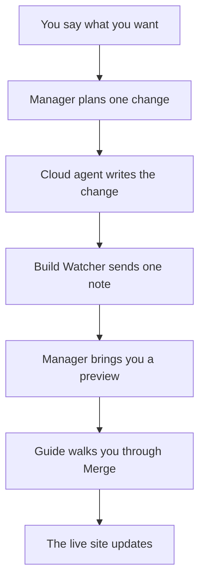

# Workshop Intro

Build one real thing on the internet, and watch bots hand the work to each other.

You are in a repo, a project folder of files. GitHub is the free site that stores that folder. The badge above links to the automatic checks for this repo.

## What this is

This is a learning project for people who want to make something and put it on the internet, and who are new to Grok Bot, the chat helper you talk to. You build one small website as the example, so you can see the lesson happen. The lesson is how bots, helpers with one job each, talk to each other and hand off work, and how they use a few services together to create something real.

## What you'll build, and what you'll learn

You leave with a live website, and with a way to change it that waits for your yes.

A wish is one thing you ask for, in your own words. The Manager turns one wish into one change and hands the writing of the code to a cloud agent. A cloud agent is a helper that writes the code in its own workspace. It opens a pull request, a proposed change you accept to put it on the live site.

The Build Watcher watches that change. It sends one note to the Manager: ready, or not. It does not talk to you. When the change is ready, the Manager brings you a preview, a look at the change before it goes live. The Guide walks you through Merge, the button that accepts the change. The first time, every click is explained. About a minute later the live site shows the change, and the Watcher confirms it.

If the note says the change is not ready, the Manager decides the fix and hands the writing back. It talks to you when it needs a decision, or when you have a click to make.

Four services do this together. GitHub holds the files and the pull request. The cloud agent writes the change there. Cloudflare shows the site to the world. A Worker is your site running on Cloudflare. Your Grok Bot and the other bots pass the work from one of these steps to the next.

Your main Grok Bot reads [GROKBOT.md](GROKBOT.md) and asks a few plain questions. If the paid plan is not there yet, it explains what you need and stops before it creates any bot. When the plan is in place, it creates a Guide that already has your answers. The Guide stays with you. It walks you one step at a time through accounts, a private folder for the site, and the clicks that connect the site. You then meet two bots named after your project. A site called Bakery Site gets a Bakery Site Manager and a Bakery Site Build Watcher.

These starting steps are instructions the bots read. These instructions do not copy a starter project into your folder.

| Bot | File | What it does |
| --- | --- | --- |
| Guide | [intro/bots/guide.md](intro/bots/guide.md) | Stays with you. Walks every click, login, and Merge |
| `<Project> Manager` | [intro/bots/manager.md](intro/bots/manager.md) | Talks about wishes. Hands the writing of the code to a cloud agent. Sends clicks to the Guide |
| `<Project> Build Watcher` | [intro/bots/build-watcher.md](intro/bots/build-watcher.md) | Watches the change, then sends one note to the Manager: ready or not, and later that the live site updated |

The written steps are in [intro/LOOP.md](intro/LOOP.md), [intro/ROUTINES.md](intro/ROUTINES.md), and [intro/CLOUDFLARE.md](intro/CLOUDFLARE.md).

## What you need

You need three things.

1. One paid plan, [The X Subscription](https://docs.x.ai/x-subscription/pricing), at Premium or higher. The bots, the signals that wake them when something happens, and the cloud agents that open pull requests all run on it.

   Free and Plus ($8 a month) include neither Grok Bot nor Cloud Agents. Premium ($30 a month) is the minimum that includes Grok Bot and Cursor Cloud Agents. Super and Ultra include both, with a bigger weekly allowance. Where both are included, Grok Bot and Cloud Agents share one weekly pool.

   An older Cursor Pro, Pro+, Ultra, or Teams plan that already includes both is fine. If you have SuperGrok or X Premium+ linked, check first. It may unlock Grok Bot, and it is not confirmed to include Cloud Agents. Prices as of Nov 2026. Check the [pricing page](https://cursor.com/pricing).

2. A free GitHub account.
3. A free Cloudflare account. The free Workers plan is enough.

The one cost is that paid plan. GitHub Free and Cloudflare Workers Free are enough. Free Workers Builds include 3,000 minutes a month for builds, and one build at a time. Preview links are public by default, even when the GitHub folder is private. The first time a cloud agent runs, it asks you to set a spend limit, a cap on what it can spend. These instructions add no other paid service. How cloud agents are billed is on the [Cloud Agents page](https://cursor.com/docs/cloud-agent).

## How to start

Tell your Grok Bot this. Where it says `<repo URL>`, put the web address of this repo.

> Read GROKBOT.md in <repo URL> and set me up

[GROKBOT.md](GROKBOT.md) is the note your main bot reads first.

## Where to go next

This is a starting point. This process, and the things you build with it, is a gateway to a wide world of creativity. You will have made one real thing, and you will have seen the handoff: you ask, the bots pass the work along, you look, and you say yes. A bigger wish can start from that same handoff.

When one wish no longer fits one change, the optional extras are the next step. They are listed in [modules/README.md](modules/README.md).

- A loop on your own computer that takes big work in tiny steps.
- A stricter check that the work still matches your words.
- A map of the code, for a site with JavaScript, TypeScript, or Python. It is free and needs no key. A simple page gets little from it.
- A security review in small passes, before the site really opens.
- A helper that looks after a computer you use to build.

The steps above stand on their own. You can learn the handoff before you add an extra.

## Advanced

The loop extra includes `init.sh`, a setup script, for that later path.

## Contributing

See [CONTRIBUTING.md](CONTRIBUTING.md). Security reports go through [SECURITY.md](SECURITY.md). License: [MIT](LICENSE).
