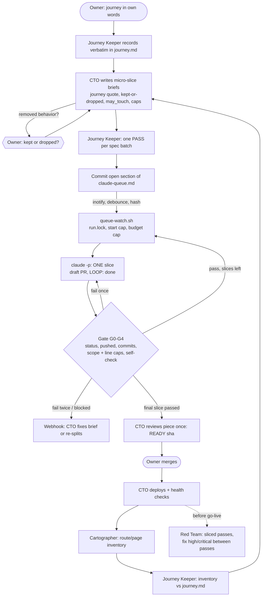

# project-kit

**A starter kit for building software with a small team of AI bots and one human owner.** One command
scaffolds a new project with a journey-first spec process, a gated headless Claude Code build loop driven by
a queue of small briefs, and five bot roles that keep each other honest.

> Status: early, used in anger on one real product. Expect sharp edges; issues and PRs welcome.

## The workflow

| Who | Does |
| --- | --- |
| **Owner** (human) | Describes user journeys in their own words, answers "kept or dropped?", merges PRs, approves anything public. |
| **CTO bot** | Turns journeys into micro-slice briefs, queues them, reviews each finished piece once, deploys after the owner merges. |
| **Cartographer bot** | Maps the code: context packs for briefs, route/page inventory after every deploy, Red Team slices. |
| **Journey Keeper bot** | Keeps `journey.md` verbatim; PASS/FAIL on specs and post-deploy inventories against it. |
| **Lab Warden bot** | Owns the machine: approves services, ports, containers, installs; hands out resource limits. |
| **Red Team bot** | Attacks the code in sliced passes, shared core reviewed once. |
| **Claude loop** (headless) | Builds exactly one slice per run, inside a declared file scope, then stops. |



## Why it works

- **Journey-first specs in the owner's words.** `journey.md` is the source of truth and is never paraphrased. Every brief quotes it with a commit and line, so "what did the owner actually ask for?" always has a checkable answer.
- **"Kept or dropped?" for removed behavior.** Bots are great at quietly deleting things that look unused. Every behavior a change removes is listed and answered by the owner before it is queued.
- **Micro-slices with `may_touch` scope.** Each run gets one small brief with an explicit file allowlist and line caps. Small, declared diffs are what make bot-written code reviewable by a person.
- **A gated loop (G0-G4)** with zero model tokens: status line, clean and pushed, real commits, scope and line caps, self-check. One automatic fix run, then it stops and asks. See [loop/GATES.md](loop/GATES.md).
- **Per-run cost caps.** Each slice gets `min(slice cap, piece budget left)`; spend is read from the run's own totals. Too-big briefs stop before they start.
- **Capped, sampled test growth.** Targeted tests on non-final slices, the full suite once per piece, tests at most ~35% of a slice, no tests that assert refusals the journey does not want.
- **Post-deploy inventory.** After every deploy the reachable routes and pages are listed and checked against the journey, so leftovers and surprise pages get caught at the source.
- **Red Team in sliced passes.** Shared core reviewed once; each surface gets its own files plus signature stubs of the core it calls; every slice fits a context window. See [redteam/SLICING.md](redteam/SLICING.md).
- **The owner stays the gate.** Bots never merge, approve or push to PR branches; secrets never go in chat; machine changes need the Lab Warden.

## Quickstart

Requirements: Linux with systemd (user units), `bash`, `git`, `jq`, `flock`, `inotify-tools`, `curl`
(webhook only), Python 3.9+ (slicer only), and the Claude Code CLI.

```bash
git clone <this repo> project-kit && cd project-kit
./init.sh my-app --dry-run            # preview: prints every path and the unit name, creates nothing
./init.sh my-app                       # scaffolds ~/projects/my-app (or --root DIR); installs nothing
```

Then follow the printed next steps:

1. **Journey interview.** Write the owner's journeys into `review-log/docs/brain/journey.md`, verbatim.
2. Fill `START.md` and `rules.md`.
3. Edit `loop/loop.env`: `LOOP_APP_REPO`, `LOOP_CLAUDE_BIN`, `LOOP_CLAUDE_FLAGS` (a permission allowlist), budgets.
4. Make `loop/bin/self-check.sh` run your linter and tests.
5. Preview: `LOOP_CONFIG=~/projects/my-app/loop/loop.env ~/projects/my-app/loop/bin/queue-watch.sh --plan`
6. Install and start the user unit (commands are printed by `init.sh`). The first start only records a baseline.
7. Flip `F0` (a trivial hello-loop piece) to `open`, commit, and watch a draft PR appear.
8. Give each bot its persona from [`bots/`](bots/).

## What's in the box

```
init.sh                         one-command project scaffold (--root, --dry-run; refuses to overwrite)
loop/
  queue-watch.sh                the watcher: inotify -> hash -> lock -> claude -p -> gate -> chain/stop -> webhook
  GATES.md                      the G0-G4 gate spec, partial vs full self-check
  _loop.md.template             Claude's standing rules, inlined into every prompt
  brief.template.md             goal, journey quote, kept-or-dropped, may_touch, caps, acceptance
  claude-queue.md.template      queue format + a staged hello-loop piece
  F0.1.brief.md.template        the hello-loop brief
  loop.env.example              every config key, documented
  notify.env.example            webhook key (chmod 600, never committed)
  self-check.example.sh         G4 gate stub with --full / --partial
  claude-watch.service.template systemd user unit
brain/                          START, rules, journey, decisions, review-log conventions (templates)
bots/                           common rules + cto, cartographer, journey-keeper, lab-warden, red-team
redteam/SLICING.md, slicer.py   slicing method and a stdlib-only slicer
tests/smoke.sh, leak-scan.sh    end-to-end smoke tests (fake Claude) and a secret/identifier scanner
```

## Isolation between projects

Everything `init.sh` creates is namespaced by the project name: `<root>/<name>/` for docs, config, state and
the loop worktree, and `<name>-claude-watch.service` for the unit. It refuses if either already exists, builds
in a temp dir and moves it into place in one step, and copies the watcher into the project so upgrading the kit
never changes a running project. Nothing is installed, enabled or started for you.

## Security notes

- The webhook key is read from a chmod-600 env file and sent through curl's stdin config, never argv.
- `LOOP_CLAUDE_FLAGS` should be a narrow permission allowlist. The loop rules forbid Claude from widening its own permissions; the gate catches out-of-scope files.
- `tests/leak-scan.sh` fails on keys, tokens, private keys, UUIDs, emails, URLs and home paths. Point `LEAK_TERMS_FILE` at a private word list (kept outside the repo) to also guard names you never want published.

## Development

```bash
make check     # shellcheck (or bash -n), python compile, smoke tests, leak scan
```

See [CONTRIBUTING.md](CONTRIBUTING.md). Licensed under the [MIT License](LICENSE).
