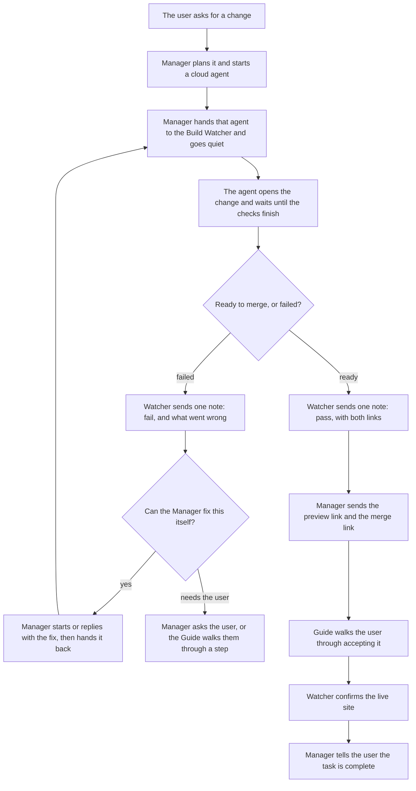

# The Intro loop

The user asks for a change in their own words. The Manager plans it and hands the coding to a Cursor cloud agent, the same way a person would hand that work to Claude. That keeps the Manager's own chat free for the wish. The Build Watcher watches that agent. When the change is ready, the user gets a preview link and a link to accept it. The Guide walks them through accepting it, one step at a time. After they do, the Watcher confirms the live site, and the Manager tells them it is done.

A pull request is a proposed change the user accepts to put it on the live site. A preview is a look at that change before it is live. A cloud agent is a helper that does the coding in its own workspace.

Read [CLOUDFLARE.md](CLOUDFLARE.md) for the preview link, the check name, and the signals that do not arrive. Read [ROUTINES.md](ROUTINES.md) for the events that do.

## Roles in the loop

| Who | Does this | Stays quiet about |
| --- | --- | --- |
| User | Says the wish. Looks at the preview. Accepts the change when they like it. | Writing the code |
| Guide | Every click, sign-up, login, approval, and merge. One step at a time. Reports back. | Deciding what the site should say. Launching code |
| Manager | Plans one slice. Launches the cloud agent. Decides every fix. Talks to the user only at the four moments below. | Clicks, logins, and watching the build |
| Build Watcher | Adopts the cloud agent. Checks the pull request. Sends one digest. Confirms the live site after the merge. | The user. The Guide. Any fix |
| Cloud agent | Edits the files in the slice, opens the pull request, waits for the checks, and reports. | New wishes. Deciding a fix. Merging |

One role per bot. The Manager talks with the user about the wish. The Guide talks with the user about steps. The Watcher talks to the Manager.

## The loop



## When the Manager talks to the user

The Manager follows a change all the way through. It stops and talks to the user only in these moments:

1. **A pull request is ready to merge.** It sends the preview link and the link where the user accepts the change. The clicks go to the Guide.
2. **A decision is needed.** One plain question, when the journey does not already have the answer.
3. **The user must do something.** A click, a login, a code from their phone, an approval, or a merge. The Manager always hands that to the Guide. The Guide walks them through it one step at a time.
4. **The task is complete.** After the user merges, the Watcher confirms the live site deployed, and the Manager tells them it is done.

Starting the work, handing it to the Watcher, and a failed check the Manager can fix are not one of these moments. The Manager does not send a progress chat for them.

## End to end

1. The user says a wish in their own words. The Manager reads `docs/project.md` (the project brief) and `docs/journey.md`, then appends those words to `docs/journey.md`.
2. The Manager opens one GitHub issue in the slice format below. That issue is the plan.
3. The Manager launches one Cursor cloud agent with the brief below. The coding happens in that agent, so the Manager's own context stays about the wish.
4. In that same turn, the Manager sends the agent's id and the pull request goal to the Build Watcher (`SendToAgent`). The Watcher adopts the agent (`CloudAgent` action `watch`, with `confirm: true`), so the agent's finish wakes the Watcher. The Manager then stops watching that agent (`unwatch`) and goes quiet.
5. The cloud agent opens one pull request, waits until that pull request's checks finish, and reports the preview URL, the check results, and what changed. Its finish is the signal that the preview is ready to look at. The cloud agent is the one that waits. The bots do not poll.
6. The Watcher looks up the pull request's checks itself. It does not take the agent's word alone. A `pr-opened` wake checks the current check state first, because Cloudflare starts the build when the branch is pushed, and the build may already be done. If the checks are still running, the Watcher sends nothing. The agent's finish will wake it. A check watch on that one pull request number did not fire in testing, so the Watcher does not create one (see [ROUTINES.md](ROUTINES.md)).
7. When the pull request is ready to merge (checks green, and the preview works) or it has failed, the Watcher sends the Manager one digest: the pull request link, the preview link, pass or fail, and the failure details. Then it stops.
8. On a failure, the Manager decides. It launches a new cloud agent, or replies to the same one, with the fix it wants. It hands that agent back to the Watcher the same way as step 4. The Watcher never asks the agent to fix anything, and never launches a fix. A fix the Watcher chose could be one the Manager does not accept. Repeat until the pull request is ready, or until one of the four moments above is the honest next step.
9. On a pass, the Manager tells the user the change is ready, with the preview link and the merge link, and sends the Guide one handoff to walk them through accepting it. The merge link is the pull request.
10. After the user merges, two wakes together let the Watcher confirm the live site: `pr-merged`, and `ci-passed` on `main` (`ciBranch` set to `main`) for the check `Workers Builds: <worker-name>`. The Watcher sends the Manager a one-line digest. The Manager tells the user the task is complete.

A change of mind comes to the Manager in the chat, in the user's words. A comment on the pull request is not a wake-up. Cloudflare's preview comment does not fire a comment trigger. The preview URL comes from the agent's report or the check-run details.

If the same failure comes back unchanged, that is a decision. The Manager asks one plain question instead of launching the same fix again. If the way forward is a click, a login, or an approval, the Manager sends the Guide a handoff. The Watcher never messages the user, and it never messages the Guide.

## Slice format

The Manager writes this as the GitHub issue. One issue, one pull request.

```markdown
## Goal
<the wish, in the user's words, one or two sentences>

## Files
- `<path>` — <why this file>

## Done when
- [ ] <something a person can see on the preview>
- [ ] The pull request description has a done note.
- [ ] The check `Workers Builds: <worker-name>` passed, and any tests passed.
- [ ] The report includes the preview URL, the check results, and what changed.

## Line cap
<number>
```

The line cap is a number the wish can finish inside. Use 80 changed lines (additions plus deletions) unless the wish is smaller. The Intro cap is 300. A wish that needs more than one slice waits for the [claude-code-loop module](../modules/claude-code-loop/MODULE.md), or the user picks the single slice to do first.

Journey quotes stay in `docs/journey.md`. The issue points at the journey lines it serves. The Manager does not paraphrase the journey inside the issue goal. The goal is the user's words.

## Prompt the Manager gives the cloud agent

Include the issue number, the line cap, the file list, and these rules:

- Change only the files listed on the issue.
- Stay inside the line cap.
- Do not add secrets, tokens, private keys, or environment files.
- Open one pull request. Put a done note in the description: what changed, and how you checked it. Do not comment on the pull request.
- Do not finish when the push succeeds. Wait until this pull request's checks finish. Those checks are `Workers Builds: <worker-name>` and any tests this repository runs.
- Then report three things: the preview URL, the check results, and what changed. Read the preview URL from the check-run details. A Cloudflare comment is not the signal.
- If a check fails, report the failure and stop. Do not fix it unless the Manager replies and asks for that fix.
- A missing top-level `"previews": {}` block in `wrangler.jsonc` is a common reason a preview build fails. Report it. The Manager decides the fix. The hello site's config already has the block (see [CLOUDFLARE.md](CLOUDFLARE.md)).

When the codegraph module is on, the brief also starts with the install lines in [the codegraph module](../modules/codegraph/MODULE.md). The Intro hello page is plain HTML. That map does not index HTML, so the default brief does not install it.

## What the Watcher checks

The Watcher looks these up when an event wakes it. It does not poll between wakes. Any miss is a fail digest. The Watcher does not repair the miss.

1. **Checks.** `Workers Builds: <worker-name>` passed, and so did any tests the repository runs. If the repository has no tests, record `none`.
2. **Preview.** The preview URL came from the agent's report or the check-run details, and the wish is visible there. Do not invent the URL. Do not take it from a Cloudflare comment.
3. **Planned files only.** Every changed file is on the issue's file list. The lockfile is allowed when `package.json` changed.
4. **Line cap.** Additions plus deletions are at or under the issue's line cap.
5. **No secrets.** The diff has no tokens, private keys, passwords, or environment files.
6. **What changed.** The agent's report says what changed. The pull request description has the done note.

On a `pr-opened` wake, the Watcher does the checks item first. Cloudflare may already have finished, because the build starts on the branch push. If the checks are still running, it sends nothing. The cloud agent's finish is still coming.

On the agent's finish, if the checks are still running, that is a fail. The agent stopped early, and no check event on that pull request will wake the Watcher. It sends the fail digest so the Manager can tell the agent to keep waiting.

If the Watcher already sent a digest for this commit, it sends nothing when a later wake sees the same commit. A new finish, with a new commit, is a new result.

## Fix rounds

A fix round belongs to the Manager. The Watcher never starts one.

- The Manager launches a new cloud agent, or replies to the agent that owns the pull request.
- The message names the failed item and the fix the Manager wants, and it repeats the cloud-agent rules above.
- The Manager then hands off again, in the same turn: `SendToAgent` with the agent id and the goal, then `unwatch`, then quiet.
- The Watcher adopts the agent again (`CloudAgent` action `watch`, `confirm: true`) so the new finish wakes the Watcher.
- The Manager does not ask the user about a failure it can fix inside the slice.

## Digest format

The Build Watcher sends exactly one of these to the Manager, and nothing else about that wake.

```text
DIGEST
pr: <link>
preview: <link or none>
result: pass | fail
detail: <what changed, or what failed>
```

`result: pass` means ready to merge: the checks are green and the preview works. `detail` is what changed.

`result: fail` means not ready. `detail` names the check, what it said, and anything else that missed (no preview URL, files outside the slice, a secret, over the line cap).

After the live deploy, one line:

```text
DIGEST live pr: <link> site: <link> seen: yes | no
```

`seen: yes` means the change is on the live page. `seen: no` means the main build passed and the page did not show the change on that one look. The Watcher does not look again on a timer.

If the main build fails, one line:

```text
DIGEST live-fail pr: <link> detail: <what the main build said>
```

## Handoff to the Guide

Any bot that needs the user to do something sends this to the Guide and waits. The Manager uses it for every merge and for every step the user must take. The primary bot uses it for sign-ups and connections during setup only by creating the Guide and letting the Guide run the checklist. Nobody else writes the click path.

```text
HANDOFF
to: Guide
from: <bot name>
project: <display name>
needed: <what the user must do, in plain words>
why: <one sentence>
done when: <what the Guide confirms before it reports back>
```

The Guide answers with `HANDOFF done`, as written in [bots/guide.md](bots/guide.md).

The Manager turns a pass digest into one plain message to the user, with the preview link and the merge link, plus that handoff. The Guide explains the first merge one click at a time. The Manager does not add the clicks.

The Manager turns `DIGEST live` with `seen: yes` into one celebration, what changed on the live site, and one suggested next wish from the journey. It does not start that wish. It does not add click steps. `seen: no` is still the task completing: the Manager gives the user the live link and says the page can take about a minute to catch up. It does not launch more coding for that delay.

A `DIGEST live-fail` is the Manager's to decide. If the user must open a page, sign in, or approve something, that is a Guide handoff. If the cause is in the code, the Manager plans a fix and hands a cloud agent to the Watcher.

## Habits

- Events wake bots. Timers, polling, and heartbeats do not. Every wake is an event.
- Read `docs/journey.md` before planning. Write the user's words there unchanged.
- One wish, one slice, one pull request.
- The user accepts a change onto the live site. The Guide walks them through it. Bots do not merge, approve, or push to the pull request branch.
- The Manager never walks the user through a technical step. That handoff goes to the Guide.
- The Manager and the Build Watcher never comment on pull requests. This loop does not move by comments.
- The Watcher never asks the cloud agent to fix something, and never launches a fix.
- One digest, then stop. A quiet wake does not produce a second message.
- Private repository by default.
- A judgment call is a product question the journey does not answer, a wish that no longer fits the slice, or the same failure coming back unchanged. A failed test the Manager can fix inside the slice is the Manager's next fix, not a question for the user.
