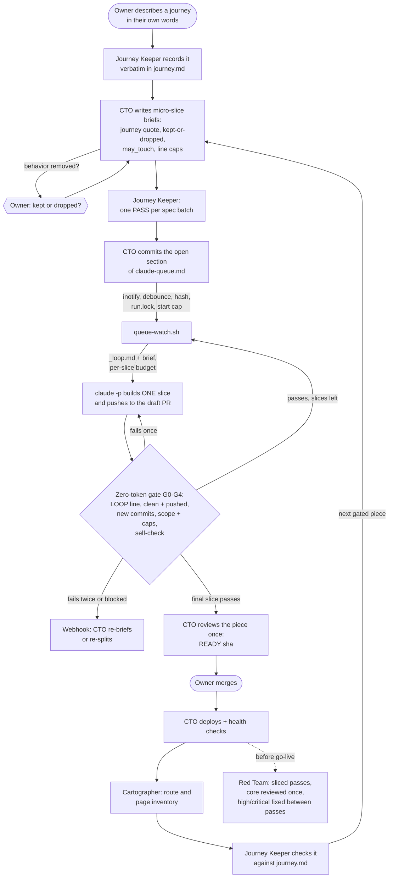

# Advanced loop guide

This is the local micro-slice loop. Newcomers start at the repository [README](../../README.md) and [GROKBOT.md](../../GROKBOT.md). Use this guide when a wish no longer fits one Intro slice.

The kit root `init.sh` scaffolds a project. It reads the templates in this module and the journey template in `modules/journey-keeper/`. It never installs, enables, or starts anything.

## Roles

| Role | File | Owns |
| --- | --- | --- |
| Owner | human | Journeys in their own words, kept-or-dropped answers, merges, anything public |
| CTO | [cto.md](cto.md) | Briefs, the queue, one review per piece, deploys after the owner merges |
| Cartographer | [../codegraph/cartographer.md](../codegraph/cartographer.md) | Code map, route inventory, red-team slice plans |
| Journey Keeper | [../journey-keeper/journey-keeper.md](../journey-keeper/journey-keeper.md) | `journey.md` verbatim, one PASS or a detailed FAIL per batch |
| Lab Warden | [../lab-monitor/lab-warden.md](../lab-monitor/lab-warden.md) | Machine layout, services, ports, loop installs |
| Red Team | [../redteam/red-team.md](../redteam/red-team.md) | Sliced adversarial passes |
| Build loop | [loop/_loop.md.template](loop/_loop.md.template) | Exactly one slice per run, inside `may_touch`, ending in a draft pull request |

Every advanced bot also follows [common.md](common.md). The Intro bots (Manager, Build Watcher) are a separate tier. Do not paste both tiers into one bot.

## The loop



The gate is specified in [loop/GATES.md](loop/GATES.md). Red-team slicing is [../redteam/SLICING.md](../redteam/SLICING.md). `slicer.py` automates the plan for Python.

The watcher is event-driven: a committed change to the open queue section starts a run. The first start only records a baseline. Details are in the header of [loop/queue-watch.sh](loop/queue-watch.sh).

## Scaffold

From a checkout of this kit:

```bash
./init.sh my-app --dry-run
./init.sh my-app
```

`--root` changes the parent directory (the default is `~/projects`). The project name matches `^[a-z][a-z0-9-]{1,38}$` and does not end with a hyphen. `init.sh` refuses when the directory or the user unit name already exists.

A scaffolded project:

```text
~/projects/my-app/
  review-log/     git repo, branch review-log: docs/claude-queue.md, docs/briefs/, docs/brain/
  loop/           loop.env, notify.env, the unit file, bin/queue-watch.sh, bin/self-check.sh
  state/          run.lock, last-run.log, runs/, cost/, passed/, gate/
  wt-loop-run/    the one worktree the builder uses (created on the first run)
```

## Configure and run

1. Edit `~/projects/my-app/loop/loop.env` (mode 600). Set `LOOP_APP_REPO` to the app clone, `LOOP_CLAUDE_BIN` to the absolute path of the Claude Code CLI, and `LOOP_CLAUDE_FLAGS` to a narrow permission allowlist.
2. Edit `LINT_CMD` and `TEST_CMD` in `~/projects/my-app/loop/bin/self-check.sh`.
3. Optional webhook: `LOOP_NOTIFY_URL` in `loop.env`, and `LOOP_NOTIFY_KEY` in `loop/notify.env` (mode 600). The key is never written to the log. The body is `{"project","event","task","slice","detail","log"}` with `Authorization: Bearer <key>`. `event` is one of `done`, `blocked`, `limit`, `needs-owner`, `error`.
4. Preview: `LOOP_CONFIG=~/projects/my-app/loop/loop.env ~/projects/my-app/loop/bin/queue-watch.sh --plan`
5. After the Lab Warden approves, install the unit file `init.sh` printed. The first start records a baseline and runs nothing.
6. Prove it: in `docs/claude-queue.md`, change the staged hello piece `F0` to `` `open` `` and commit on the `review-log` branch.

Create one bot per role. Paste `common.md` plus that role's file. Point each bot at `review-log/docs/brain/START.md`. A webhook routine that wakes the CTO on `blocked` or `done` closes the loop. That routine fires when a run finishes. It is not a timer.

## Configuration

All keys live in `loop/loop.env`, re-read before every check. The unit sets `LOOP_CONFIG`. Defaults below match [loop/loop.env.example](loop/loop.env.example).

| Key | Default | Meaning |
| --- | --- | --- |
| `LOOP_PROJECT` | set by init | Project name, `[a-z][a-z0-9-]{1,38}` |
| `LOOP_DOCS` / `LOOP_STATE` / `LOOP_WT` | set by init | Review-log `docs/`, state folder, worktree |
| `LOOP_APP_REPO` | empty, required | Clone of the app repository |
| `LOOP_MAIN_BRANCH` | `main` | Base branch for task branches |
| `LOOP_QUEUE` | `claude-queue.md` | Queue file name inside `docs/` |
| `LOOP_CLAUDE_BIN` | empty, required | Absolute path of the Claude Code CLI |
| `LOOP_CLAUDE_FLAGS` | empty | Extra flags, word-split |
| `LOOP_MODEL_SECURITY` | `opus` | Model for security, fix, and debug pieces |
| `LOOP_MODEL_FEATURE` | `sonnet` | Model for everything else |
| `LOOP_PIECE_BUDGET_USD` | `5` | Budget shared by the slices of a piece |
| `LOOP_SLICE_BUDGET_USD` | `2` | Max per slice run |
| `LOOP_BRIEF_MAX_BYTES` | `20480` | Cap on `_loop.md` plus the brief |
| `LOOP_MAX_STARTS` | `4` | Starts per task hash before `needs-owner` |
| `LOOP_DEBOUNCE` | `20` | Seconds of quiet before a check |
| `LOOP_DEFAULT_MAX_LINES` / `LOOP_DEFAULT_MAX_TEST_LINES` | `300` / `120` | G3 caps when a brief sets none |
| `LOOP_SELF_CHECK` | `loop/bin/self-check.sh` | G4 command |
| `LOOP_NOTIFY_URL` | empty | Webhook URL. Empty disables notifications |
| `LOOP_NOTIFY_ENV` | `loop/notify.env` | Mode-600 file that sets `LOOP_NOTIFY_KEY` |

`init.sh` also reads `PK_PIECE_USD`, `PK_SLICE_USD`, `PK_BRIEF_BYTES`, and, for tests, `SYSTEMD_USER_DIR` and `PK_SKIP_SYSTEMCTL`.

## Safety

- The owner merges. The builder opens draft pull requests. Agents comment or record a verdict line.
- The gate rejects files outside `may_touch`, diffs over the line caps, unpushed work, and a failing self-check, without spending a model call.
- Per-slice and per-piece budgets, a brief size cap, one automatic fix run, and a start cap per task.
- `init.sh` installs nothing. The watcher's first start only records a baseline.
- Each project has its own folders, state, worktree, and unit name. The watcher is copied per project.
- The webhook key is read from a mode-600 file and passed on stdin, not argv.
- Lab changes go through the Lab Warden. Optional local-model triage follows [../lab-monitor/local-triage.md](../lab-monitor/local-triage.md).

## Principles

- `journey.md` is never paraphrased. Every brief cites it by commit and line.
- Any behavior a change removes is listed and answered by the owner before it is queued.
- Each brief declares `may_touch`. The gate rejects anything else.
- One piece is one draft pull request. Tests stay about 35% of a slice or less.
- No secrets in chat. Keys live in mode-600 files.

## Checked by

From the kit root: `make check` runs shell syntax, `python3 -m py_compile` on the slicer, `tests/smoke.sh`, `tests/structure.sh`, and `tests/leak-scan.sh`. The leak scan accepts an optional private term list outside the repo (`LEAK_TERMS_FILE`).
